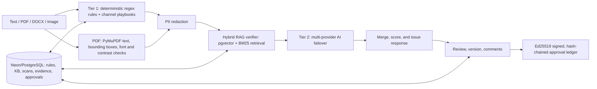

# Architecture

ClaimLoom is a FastAPI governance service with a deterministic baseline and optional AI assistance. Text and document scans remain usable when paid AI providers are unavailable.

The implementation has deterministic regex/channel checks, same-length PII redaction, PyMuPDF layout checks, optional provider failover, and signed approvals. The diagram shows the intended hybrid retrieval architecture: PostgreSQL migrations enable `pgvector` and define embeddings, and `rank-bm25` is a dependency. However, the current `rag_verifier.py` runtime path retrieves KB chunks using domain filtering and lexical overlap; pgvector and BM25 are not both active in that runtime path today. Treat the diagram node as the target architecture, not evidence that hybrid retrieval is already fully wired. When Neon is unavailable, rules and KB data can fall back to bundled seed data; features requiring database writes (such as KB edits) return an error.

## Main modules

- `claimloom-backend/main.py`: app setup, text scans, health, rules and analytics, persistence.
- `pipeline.py` / `engine.py`: deterministic checks, PII handling, verifier and AI result merge.
- `pdf_engine.py`: PDF and DOCX/Markdown ingestion, PDF page rendering and redline export.
- `vision_router.py`: image OCR/analysis and visual checks.
- `rules_router.py`, `kb_router.py`: rule optimization, Truth Vault and re-audit.
- `collab_router.py`: review comments, versions, approvals, public key and verification.
- `claimloom-ui/`: Next.js frontend. `claimloom-backend/chrome-extension/`: unpacked Chrome extension.

